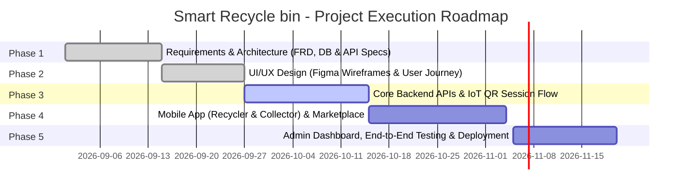

# ♻️ Smart Recycle bin
> **AI-Powered IoT Waste Classification, Gamified Recycling Platform & Fleet Operations**

[](https://opensource.org/licenses/MIT)
[](https://github.com/Smart-Recycle-bin/Smart-Recycle-bin)
[](#)
[](#)

---

## 📌 Table of Contents
1. [Project Name](#1-project-name)
2. [Project Idea](#2-project-idea)
3. [Team Members](#3-team-members)
4. [Work Plan](#4-work-plan)
5. [Roles & Responsibilities](#5-roles--responsibilities)
6. [Key Performance Indicators (KPIs)](#6-key-performance-indicators-kpis)
7. [Instructor & Supervision](#7-instructor--supervision)
8. [Project Files & Architecture](#8-project-files--architecture)

---

## 1. Project Name
- **Project Title:** Smart Recycle bin
- **System Classification:** IoT & AI-Driven Solid Waste Management & Gamified Recycling Ecosystem
- **GitHub Repository:** [`Smart-Recycle-bin`](https://github.com/Smart-Recycle-bin/Smart-Recycle-bin)

---

## 2. Project Idea
### 💡 Executive Summary
**Smart Recycle bin** is an end-to-end smart waste management ecosystem that bridges Internet of Things (IoT), Computer Vision / Artificial Intelligence (AI/ML), cross-platform mobile apps, and cloud administration dashboards. It transforms traditional waste disposal into an automated, gamified, and ecologically accountable experience.

The system addresses solid waste accumulation and lack of source-segregation across three integrated tiers:

1. **AI-Enabled IoT Smart Bins:**
   - Embedded sensors and cameras automatically unlock the bin lid upon scanning a dynamic QR code via the mobile app.
   - High-speed onboard cameras capture images of inserted items.
   - An integrated machine learning engine classifies waste types (`PLASTIC_BOTTLE`, `ALUMINUM_CAN`, `GLASS`, `PAPER`, `ORGANIC`) in real time, calculating reward points within an active 60-second renewed session window.

2. **Unified Dual-Role Mobile Application:**
   - **For Citizens / Recyclers:** Scan bin QR code to unlock sessions, review real-time classification survey results, earn reward points, track an immutable append-only wallet ledger, redeem points for merchant vouchers in a digital marketplace, and compete on community gamification leaderboards.
   - **For Municipal Collectors / Operators:** Single unified login with dynamic role-based routing (RBAC). Collectors view assigned bins geographically, inspect real-time fill percentages, monitor predictive fill-time models, receive critical overflow alerts, and record servicing actions ("Mark as Serviced") with zero-fill reset.

3. **Cloud Web Admin Dashboard:**
   - Centralized management of the container fleet, bin geolocation, capacity thresholds, and district assignments.
   - Exclusive authority for provisioning and managing Collector accounts.
   - Real-time audit logs of all administrative mutations, ledger adjustments, and voucher redemptions.
   - Active learning review queue: disputed or flagged classifications are inspected by administrators to continuously retrain the AI models.

```
       [ Citizen App ]                         [ Collector App ]
              │                                        │
     (Scan QR / Earn Points)                  (Monitor & Service Bins)
              │                                        │
              ▼                                        ▼
    ┌────────────────────────────────────────────────────────┐
    │              RESTful APIs / Backend Cloud              │
    │         (Auth, Wallet Ledger, Fleet Management)        │
    └────────────────────────────────────────────────────────┘
              ▲                    ▲                   ▲
              │                    │                   │
    ┌─────────┴─────────┐ ┌────────┴─────────┐ ┌───────┴────────┐
    │  Smart IoT Bin    │ │   ML Classification  │ │ Web Admin Hub  │
    │  (Cam & Sensors)  │ │   (Image Detection)  │ │ (Analytics)    │
    └───────────────────┘ └──────────────────────┘ └────────────────┘
```

---

## 3. Team Members

| # | Member Name | Role & Specialization | Key Responsibilities |
|---|-------------|-----------------------|----------------------|
| 1 | **Youssef Mohamed Hussein Mostafa** | **Team Leader & Full-Stack .NET Engineer** | • Overall project leadership and system architecture design.<br>• Core backend APIs, cloud integration, and microservices coordination.<br>• End-to-end integration across IoT, mobile, and web modules. |
| 2 | **Moaz Sayed Abosreea Elsayed** | **Mobile Application Developer** | • Unified mobile app development (Flutter / Cross-Platform).<br>• Dynamic QR code scanning and real-time session loop UX.<br>• Role-based interface switching (Recycler vs. Collector). |
| 3 | **Ahmed Abo Bakr Abdelmoneim Mokhaimer** | **Backend & Database Engineer** | • Relational database schema design and ACID ledger transactions.<br>• JWT-based IAM authentication, profile, and authorization routes.<br>• RESTful API endpoints implementation and Swagger/OpenAPI documentation. |
| 4 | **Zeinab Mamdouh Abdallah Hassan** | **Frontend Web & UI/UX Developer** | • Web Admin Dashboard development (fleet management & analytics).<br>• UI/UX wireframing and interactive prototypes on Figma.<br>• Interactive fleet mapping and live telemetry data visualizations. |
| 5 | **Mohamed Mostafa Mohamed Abdelghani** | **AI & Embedded Systems Engineer / QA** | • Waste image dataset curation and ML classification model training.<br>• Embedded IoT controller logic, camera triggers, and telemetry hooks.<br>• Unit, integration, automated regression testing, and quality assurance. |

---

## 4. Work Plan

The project execution is organized following the **Agile / Scrum** framework across 5 core phases:



| Phase | Title | Key Deliverables & Scope | Timeline |
|-------|-------|--------------------------|----------|
| **Phase 1** | **Requirements Analysis & Architecture** | Functional Requirements Document (FRD v2.0), relational database modeling, and comprehensive RESTful API specifications. | 2 Weeks |
| **Phase 2** | **UI/UX Design & Prototyping** | User journey maps, wireframes, and interactive design prototypes (Figma) for Mobile and Web Admin views. | 2 Weeks |
| **Phase 3** | **Core Backend & IoT Engine** | JWT authentication, QR session engine (60s loop), ACID transaction ledger, and ML model inference pipeline. | 3 Weeks |
| **Phase 4** | **Mobile App & Gamified Marketplace** | Recycler onboarding, collector dashboard, digital voucher marketplace, and dynamic leaderboards. | 3 Weeks |
| **Phase 5** | **Admin Dashboard, Testing & Release** | Fleet management portal, audit logging, active learning review queue, end-to-end testing, and production deployment. | 2 Weeks |

---

## 5. Roles & Responsibilities

### A. System Actors Roles
1. **Recycler / Citizen (`USER_CITIZEN`):**
   - Self-registers via the mobile app using email and password.
   - Scans bin QR codes to open timed disposal sessions.
   - Reviews post-disposal classification survey and confirms/rejects items.
   - Earns redeemable reward points, tracks ledger history, and claims digital discount vouchers.
2. **Collector / Bin Operator (`OPS_COLLECTOR`):**
   - Logs into the unified mobile app with collector credentials provisioned by administrators.
   - Views geographically assigned bins, live telemetry, and predictive fill times.
   - Receives critical fill alerts ($\ge 80\%$ and $\ge 95\%$) and executes "Mark as Serviced" to reset fill levels.
3. **System Administrator (`SYS_ADMIN`):**
   - Holds exclusive provisioning authority for creating Collector accounts.
   - Manages physical bin fleet registration, coordinates, thresholds, and district assignments.
   - Administers rewards catalog, performs manual ledger adjustments with mandatory audit justification, and inspects disputed surveys for active model retraining.

### B. Team Member Responsibility Matrix
- **Youssef Mohamed Hussein Mostafa (Team Leader):**
  - Architectural blueprint oversight, technology stack governance, and microservice/API standards.
  - Development of core cloud business services and end-to-end platform orchestration.
- **Moaz Sayed Abosreea Elsayed (Mobile Engineer):**
  - Shared mobile codebase in Flutter with role-based routing between Citizen and Collector interfaces.
  - Device camera QR scanner integration, disposal session countdown timers, and survey verification UX.
- **Ahmed Abo Bakr Abdelmoneim Mokhaimer (Backend Engineer):**
  - Database schema implementation with strict ACID guarantees for the append-only ledger.
  - Security endpoints: JWT issuance, password recovery flows, and user moderation APIs.
- **Zeinab Mamdouh Abdallah Hassan (Frontend & UI/UX):**
  - Figma user journey designs and interactive prototypes.
  - Responsive Web Admin Dashboard building with real-time maps and analytics charts.
- **Mohamed Mostafa Mohamed Abdelghani (AI & QA Specialist):**
  - Computer vision waste classification model training, optimization, and inference validation.
  - Test suites: unit, functional, integration, load testing, and edge-case failure verification.

---

## 6. Key Performance Indicators (KPIs)

| Metric Category | Key Performance Indicator (KPI) | Target Metric | Verification Method |
|-----------------|---------------------------------|---------------|---------------------|
| **AI Performance** | Waste Classification Accuracy | $\ge 95\%$ | Ratio of user-confirmed vs. disputed AI classifications |
| **System Latency** | Average API Response Time | $< 200 \text{ ms}$ | APM monitoring under standard and peak concurrency |
| **Session Operations** | Active Disposal Window | $60 \text{ sec}$ | Automatically renewed upon each consecutive item inserted |
| **Financial Integrity** | Financial Ledger Consistency | $100\%$ Match | Zero ledger discrepancies across credits, debits, and adjustments |
| **Operational Efficiency** | Bin Overflow Incidents | $< 3\%$ | Collector alerts dispatched before critical container overflow |
| **Sorting Quality** | Waste Contamination Rate | $< 5\%$ | Rate of non-recyclables or misclassified items in target containers |
| **User Engagement** | Voucher Redemption Rate | $> 60\%$ | Ratio of earned reward points exchanged for active marketplace vouchers |

---

## 7. Instructor & Supervision
- **Instructor / Academic Supervisor:** **[Instructor Name]**
- **Training Initiative / Track:** Software Development Track (Full-Stack / Mobile / Cloud)
- **Supervising Institution:** YAT Learning Centers / Information Technology Institute (MCIT / DEPI Initiative)

---

## 8. Project Files & Architecture

### 📁 Repository Directory Structure
```
Smart-Recycle-bin/
├── docs/                                          # Comprehensive Documentation & Specifications
│   ├── Smart-Waste-Management-Features.md         # Feature Prioritization & Scenarios (Must/Should/Could)
│   ├── FRD-Smart-Waste-System.md                  # Functional Requirements Document (FRD v2.0)
│   └── APIs.md                                    # Complete RESTful API Specifications & Contracts
├── src/                                           # Project Source Code
│   ├── backend/                                   # ASP.NET Core Web API & Entity Framework Core
│   ├── mobile/                                    # Flutter Shared Mobile Application (Citizen & Collector)
│   ├── web-admin/                                 # Web Admin Dashboard (React / Angular / Blazor)
│   └── iot-ai/                                    # ML.NET Model & Embedded IoT Bin Controller Scripts
├── .gitignore                                     # Git Ignore Rules
└── README.md                                      # Primary Project Documentation
```

### 🔗 Project Deliverable Links
- **Interactive UI/UX Prototype:** [Figma Design Prototype](https://www.figma.com/) *(Add Figma Link)*
- **Project Presentation & Cloud Drive:** [Google Drive Folder](https://drive.google.com/) *(Add Google Drive Link)*
- **Technical Documentation Directory:** [Browse `docs/` Folder](./docs/)
  - [Feature Prioritization & Scenarios (Smart-Waste-Management-Features.md)](./docs/Smart-Waste-Management-Features.md)
  - [Functional Requirements Document (FRD-Smart-Waste-System.md)](./docs/FRD-Smart-Waste-System.md)
  - [RESTful APIs Specification (APIs.md)](./docs/APIs.md)

---

### 🛡️ Submission Checklist
- [x] **Repository Name:** Clear and descriptive (`Smart-Recycle-bin`).
- [x] **Repository Description:** Concise and informative summary added to GitHub About section.
- [x] **Visibility:** Repository settings verified as **Public**.
- [x] **README Content:** All 8 mandated sections fully completed:
  - [x] Project Name
  - [x] Project Idea
  - [x] Team Members
  - [x] Work Plan
  - [x] Roles & Responsibilities
  - [x] KPIs
  - [x] Instructor
  - [x] Project Files
- [x] **Source Files & Architecture:** System documentation files and source tree organized inside the repository.
