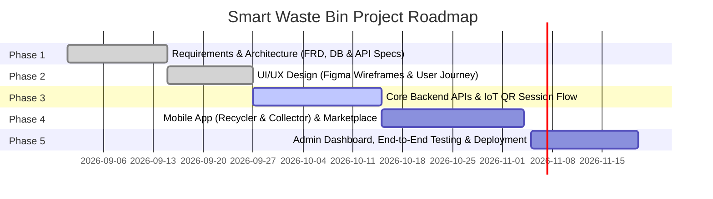

# ♻️ Smart Waste Bin System (سلة النفايات الذكية)
> **AI-Powered IoT Waste Classification, Gamified Recycling Platform & Fleet Operations**

[](https://opensource.org/licenses/MIT)
[](https://github.com/Smart-Recycle-bin/Smart-Recycle-bin)
[](#)
[](#)

---

## 📌 الفهرس / Table of Contents
1. [Project Name (اسم المشروع)](#1-project-name-اسم-المشروع)
2. [Project Idea (فكرة المشروع)](#2-project-idea-فكرة-المشروع)
3. [Team Members (أعضاء الفريق)](#3-team-members-أعضاء-الفريق)
4. [Work Plan (خطة العمل والجدول الزمني)](#4-work-plan-خطة-العمل-والجدول-الزمني)
5. [Roles & Responsibilities (الأدوار والمسؤوليات)](#5-roles--responsibilities-الأدوار-والمسؤوليات)
6. [Key Performance Indicators - KPIs (مؤشرات الأداء الرئيسية)](#6-key-performance-indicators---kpis-مؤشرات-الأداء-الرئيسية)
7. [Instructor & Supervision (المدرب والإشراف)](#7-instructor--supervision-المدرب-والإشراف)
8. [Project Files & Architecture (ملفات المشروع وروابط التسليم)](#8-project-files--architecture-ملفات-المشروع-وروابط-التسليم)

---

## 1. Project Name (اسم المشروع)
- **English Name:** Smart Waste Bin System (Smart Recycle Bin Platform)
- **Arabic Name:** نظام سلة النفايات الذكية ومنظومة إدارة المخلفات والتدوير الرقمي
- **Repository:** [`Smart-Recycle-bin`](https://github.com/Smart-Recycle-bin/Smart-Recycle-bin)

---

## 2. Project Idea (فكرة المشروع)
### 💡 الملخص التنفيذي / Executive Summary
مشروع **Smart Waste Bin System** هو منظومة رقمية متكاملة تجمع بين إنترنت الأشياء (IoT)، الذكاء الاصطناعي (AI/ML)، وتطبيقات الموبايل والويب لتحويل عملية التخلص من النفايات إلى تجربة تفاعلية ذكية ومحفزة بيئيًا. 

يعالج النظام مشكلة تراكم النفايات وعدم فرزها من المصدر عبر تقديم:
1. **سلات نفايات ذكية (Smart Bins with IoT & Embedded AI):** مزودة بكاميرات وحساسات لفتح الغطاء آليًا عبر مسح QR Code، والتقاط صور المخلفات، وتصنيف نوعها (بلاستيك، زجاج، ورق، كانز/معادن) لحظيًا وتقدير نقاط المكافأة المكتسبة.
2. **تطبيق موبايل موحد متعدد الأدوار (Unified Mobile App):**
   - **للمواطن / المدور (Citizen / Recycler):** مسح كود السلة لبدء جلسة الإيداع (Session window: 60s)، فحص نتائج التصنيف الآلي، كسب النقاط، تتبع المحفظة الرقمية المالية (Append-only Ledger)، استبدال النقاط بقسائم شراء (Vouchers Marketplace)، والمنافسة في لوحة الشرف (Gamification Leaderboards).
   - **لعامل الجمع والتشغيل (Collector / Bin Operator):** مراقبة السلات المسندة إليه جغرافياً، متابعة نسبة الامتلاء الحية والتنبؤ بوقت الامتلاء (Predictive Fill-levels)، استقبال تنبيهات الطوارئ، وتحديث حالة الصيانة والتفريغ ("Mark as Serviced").
3. **لوحة تحكم إدارية سحابية (Web Admin Dashboard):** تمكّن الإدارة المركزية من مراقبة أسطول الحاويات، إدارة صلاحيات العاملين، فحص السجلات المالية والرقابية (Audit Logs)، تدريب الذكاء الاصطناعي على الحالات المشكوك فيها (Active Learning Pipeline)، واستعراض التحليلات والإحصائيات البيئية.

```
       [ Citizen App ]                         [ Collector App ]
              │                                        │
     (Scan QR / Points)                       (Monitor & Empty Bins)
              │                                        │
              ▼                                        ▼
    ┌────────────────────────────────────────────────────────┐
    │              RESTful APIs / Backend Cloud              │
    │         (Auth, Wallet Ledger, Fleet Management)        │
    └────────────────────────────────────────────────────────┘
              ▲                    ▲                   ▲
              │                    │                   │
    ┌─────────┴─────────┐ ┌────────┴─────────┐ ┌───────┴────────┐
    │  Smart IoT Bin    │ │   ML Classification  │ │ Web Admin Hub  │
    │  (Cam & Sensors)  │ │   (Image Detection)  │ │ (Analytics)    │
    └───────────────────┘ └──────────────────────┘ └────────────────┘
```

---

## 3. Team Members (أعضاء الفريق)

| # | Name (الاسم) | Track / Major | GitHub Profile | Email / Contact |
|---|-------------|---------------|----------------|-----------------|
| 1 | **[Team Member 1 / Team Leader]** | Full-Stack .NET / Lead | [@username](https://github.com/) | member1@example.com |
| 2 | **[Team Member 2]** | Mobile Development (Flutter) | [@username](https://github.com/) | member2@example.com |
| 3 | **[Team Member 3]** | Backend API & Database | [@username](https://github.com/) | member3@example.com |
| 4 | **[Team Member 4]** | Frontend Web (Dashboard) | [@username](https://github.com/) | member4@example.com |
| 5 | **[Team Member 5]** | AI & Embedded / Quality Assurance | [@username](https://github.com/) | member5@example.com |

> *(ملاحظة: يرجى تحديث أسماء وبيانات أعضاء الفريق وروابط حساباتهم طبقاً للقائمة المعتمدة لديكم).*

---

## 4. Work Plan (خطة العمل والجدول الزمني)

تم تنظيم العمل وفق منهجية **Agile / Scrum** مقسمة إلى 5 مراحل رئيسية:



| المرحلة (Phase) | الأهداف والمخرجات (Deliverables) | المدة الزمنية |
|-----------------|---------------------------------|--------------|
| **Phase 1: تحليل المتطلبات والتصميم المعماري** | صياغة وثيقة المتطلبات الوظيفية (FRD)، وتصميم قواعد البيانات، وتوصيف واجهات الـ RESTful APIs. | أسبوعان |
| **Phase 2: تجربة المستخدم وتصميم الشاشات** | بناء Wireframes وتصميم النموذج التفاعلي (Figma Prototype) لتطبيق الموبايل ولوحة التحكم. | أسبوعان |
| **Phase 3: تطوير النواة والخدمات السحابية** | بناء خدمات المصادقة (JWT IAM)، إدارة جلسات الـ QR، محرك الذكاء الاصطناعي لتصنيف المخلفات (ML Engine). | 3 أسابيع |
| **Phase 4: تكامل تطبيق الموبايل ونظام المكافآت** | برمجة شاشات المستخدم والمجمع، المحفظة المالية (Append-only Ledger)، ونظام قسائم الماركت بليس. | 3 أسابيع |
| **Phase 5: لوحة التحكم والتحليلات والاختبارات** | تطوير Web Admin Dashboard، تقارير الأداء وخرائط الأسطول، وإجراء اختبارات الجودة (Integration & E2E Testing). | أسبوعان |

---

## 5. Roles & Responsibilities (الأدوار والمسؤوليات)

### أ. أدوار مستخدمي النظام (System Actors Roles)
1. **المواطن / المستخدم (Recycler - `USER_CITIZEN`):**
   - التسجيل الذاتي ومسح QR Code لبدء عملية الإيداع.
   - مراجعة استبيان التدوير وتأكيد نتائج الفرز الآلي لكسب النقاط.
   - متابعة رصيد النقاط واستبدالها بقسائم خصم من المتاجر.
2. **عامل الجمع والتفريغ (Collector - `OPS_COLLECTOR`):**
   - تسجيل الدخول عبر نفس تطبيق الموبايل بتوجيه تلقائي (Role-based Routing).
   - متابعة السلات المسندة إليه جغرافياً ومعاينة مستوى الامتلاء والتوقعات.
   - تأكيد تفريغ السلة ("Mark as Serviced") لتصفير العداد إلى 0%.
3. **مدير النظام (System Administrator - `SYS_ADMIN`):**
   - الجهة الوحيدة المخولة بإنشاء وتعيين حسابات عمال الجمع (Collectors Provisioning).
   - إدارة أسطول السلات وتعيين المواقع الجغرافية والأحياء.
   - إدارة متجر المكافآت، مراجعة سجلات التدقيق (Audit Logs)، والبت في الحالات المعترضة لإعادة تدريب الذكاء الاصطناعي (Active Learning).

### ب. مسؤوليات فريق العمل التقني (Technical Team Responsibilities)
- **Backend Engineer:** بناء وتأمين واجهات البرمجة (RESTful APIs) بـ ASP.NET Core، وتطبيق المعاملات المالية الذرية (ACID Transactions)، وتوثيق Swagger/OpenAPI.
- **Mobile App Developer:** بناء تطبيق الموبايل الهجين (Flutter) بنمط واجهة موحد يتكيف تلقائياً مع دور المستخدم (Citizen vs Collector)، وتكامل الماسح الضوئي (QR Scanner).
- **Frontend Web Developer:** تطوير لوحة تحكم الإدارة (Admin Dashboard) وتصميم الخرائط الحية ومخططات الإحصائيات التفاعلية.
- **AI & Embedded Systems Specialist:** إعداد وتدريب نموذج تصنيف صور النفايات (Computer Vision)، وبرمجة دوائر الحساسات وكاميرا السلة الذكية.
- **QA & DevOps Engineer:** اختبار حالات الأمان وسلامة البيانات، ومراقبة كفاءة الأداء، وضبط إعدادات الـ CI/CD والنشر السحابي.

---

## 6. Key Performance Indicators - KPIs (مؤشرات الأداء الرئيسية)

| فئة المؤشر | مؤشر الأداء (KPI) | المستهدف (Target Metric) | آلية القياس |
|-----------|------------------|--------------------------|-------------|
| **دقة الذكاء الاصطناعي** | Waste Classification Accuracy | $\ge 95\%$ | نسبة التصنيفات الصحيحة المؤكدة من المستخدمين |
| **سرعة الاستجابة** | API Average Response Time | $< 200 \text{ ms}$ | مراقبة زمن استجابة خوادم الـ Backend |
| **زمن جلسة الإيداع** | Active Disposal Window | $60 \text{ sec}$ | نافذة إيداع زمنية تتجدد تلقائياً عند إضافة عنصر جديد |
| **سلامة القيود المالية** | Financial Ledger Integrity | $100\%$ Consistency | سجل محاسبي غير قابل للتعديل (Zero Ledger Discrepancies) |
| **كفاءة تفريغ الأسطول** | Bin Overflow Prevention | $< 3\%$ | خفض الحالات التي تصل فيها السلة إلى امتلاء حرج قبل التفريغ |
| **جودة الفرز والتلوث** | Contamination Rate | $< 5\%$ | نسبة العناصر المرفوضة أو المصنفة خطأ داخل السلة |
| **التفاعل واستبدال المكافآت** | Voucher Redemption Ratio | $> 60\%$ | نسبة استبدال النقاط المكتسبة بقسائم فعلية |

---

## 7. Instructor & Supervision (المدرب والإشراف)
- **Instructor / Supervisor:** مهندس / أستاذ المادة المشرف: **[اسم المدرب / Instructor Name]**
- **Training Initiative / Track:** منحة / برنامج تدريب تطوير البرمجيات (Software Development Track)
- **Supervising Entity:** مركز التدريب / المعهد (YAT Learning Centers / MCIT / DEPI Initiative)

---

## 8. Project Files & Architecture (ملفات المشروع وروابط التسليم)

### 📁 هيكل المستودع والملفات الفنية (Repository Directory Structure)
```
Smart-Recycle-bin/
├── docs/                                          # التوثيق الشامل والمواصفات الفنية
│   ├── Smart-Waste-Management-Features.md         # تصنيف الأولويات والخصائص والسيناريوهات
│   ├── FRD-Smart-Waste-System.md                  # وثيقة المتطلبات الوظيفية الشاملة (FRD v2.0)
│   └── APIs.md                                    # التوصيف الكامل لجميع واجهات البرمجة (API Endpoints)
├── src/                                           # الأكواد البرمجية للمشروع (Source Code)
│   ├── backend/                                   # ASP.NET Core Web API & Database Context
│   ├── mobile/                                    # Flutter Shared Mobile App (Citizen & Collector)
│   ├── web-admin/                                 # Web Admin Dashboard (React / Angular / Blazor)
│   └── iot-ai/                                    # ML.NET Model & IoT Bin Embedded Scripts
├── .gitignore                                     # استبعاد ملفات البناء المؤقتة
└── README.md                                      # دليل المشروع والتوثيق المعتمد
```

### 🔗 روابط المشروع الإضافية (Project Links & External Deliverables)
- **Interactive UI/UX Prototype (رابط تصميم فيجما):** [عرض التصميم على Figma](https://www.figma.com/) *(يرجى إدراج رابط Figma)*
- **Project Cloud Drive / Presentation (العرض التقديمي):** [ملفات العرض على Google Drive](https://drive.google.com/) *(يرجى إدراج رابط Drive)*
- **Documentation Docs Folder:** [تصفح مجلد التوثيق داخل المستودع](./docs/)
  - [عرض ملف الخصائص والسيناريوهات (Smart-Waste-Management-Features.md)](./docs/Smart-Waste-Management-Features.md)
  - [عرض المتطلبات الوظيفية (FRD-Smart-Waste-System.md)](./docs/FRD-Smart-Waste-System.md)
  - [عرض توثيق الـ APIs (APIs.md)](./docs/APIs.md)

---

### 🛡️ الاشتراطات الفنية للمراجعة والتسليم (Submission Checklist)
- [x] **اسم الـ Repository واضح ومعبر:** `Smart-Recycle-bin`
- [x] **وصف المشروع (Description) محدد:** توفير وصف دقيق في إعدادات المستودع على GitHub.
- [x] **إتاحة المستودع:** ضبط الـ Repository على **Public**.
- [x] **استكمال ملف README بالبنود الثمانية المطلوبة:**
  - [x] Project Name
  - [x] Project Idea
  - [x] Team Members
  - [x] Work Plan
  - [x] Roles & Responsibilities
  - [x] KPIs
  - [x] Instructor
  - [x] Project Files
- [x] **رفع ملفات المشروع والتوثيق:** تم تضمين ملفات الـ FRD و الـ APIs في مجلد `docs/`.
