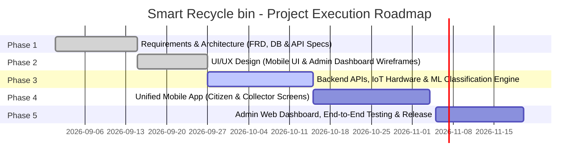

# ♻️ Smart Recycle bin
> **AI-Powered IoT Waste Classification, Gamified Recycling Platform & Fleet Operations**

[](https://opensource.org/licenses/MIT)
[](https://github.com/Smart-Recycle-bin/Smart-Recycle-bin)
[](#)
[](#)

---

## 📌 Table of Contents
1. [Project Name](#1-project-name)
2. [Project Idea](#2-project-idea)
3. [Team Members](#3-team-members)
4. [Work Plan](#4-work-plan)
5. [Roles & Responsibilities](#5-roles--responsibilities)
6. [Key Performance Indicators (KPIs)](#6-key-performance-indicators-kpis)
7. [Instructor & Supervision](#7-instructor--supervision)
8. [Project Files & Architecture](#8-project-files--architecture)

---

## 1. Project Name
- **Project Title:** Smart Recycle bin
- **System Classification:** IoT & AI-Driven Solid Waste Management & Gamified Recycling Ecosystem
- **GitHub Repository:** [`Smart-Recycle-bin`](https://github.com/Smart-Recycle-bin/Smart-Recycle-bin)

---

## 2. Project Idea
### 💡 Executive Summary
**Smart Recycle bin** is an end-to-end smart waste management ecosystem that bridges Internet of Things (IoT), Computer Vision / Artificial Intelligence (AI/ML), a single unified cross-platform mobile application, and a cloud web administration dashboard. It transforms traditional waste disposal into an automated, gamified, and ecologically accountable experience.

The system addresses solid waste accumulation and lack of source-segregation across three core tiers:

1. **AI-Enabled IoT Smart Bins:**
   - Embedded sensors and cameras automatically unlock the bin lid upon scanning a dynamic QR code via the mobile app.
   - High-speed onboard cameras capture images of inserted items.
   - An integrated machine learning engine classifies waste types (`PLASTIC_BOTTLE`, `ALUMINUM_CAN`, `GLASS`, `PAPER`, `ORGANIC`) in real time, calculating reward points within an active 60-second renewed session window.

2. **Single Unified Mobile Application (Shared App with Role-Based Routing):**
   - **Architectural Rule (`FR-RULE-001`):** Recyclers (Citizens) and Collectors operate within the **exact same mobile application build** with a single unified login screen (`AUTH-003`). Dynamic routing and screen rendering are governed strictly by the user's authenticated JWT role claim (`AUTH-005`):
     - **Citizen Mode (`USER_CITIZEN`):** Scan bin QR code to unlock sessions, review real-time classification survey results, earn reward points, track an immutable append-only wallet ledger, redeem points for merchant vouchers in a digital marketplace, and compete on community leaderboards.
     - **Collector Mode (`OPS_COLLECTOR`):** Automatically activated upon collector login (accounts provisioned exclusively by administrators). Collectors view assigned bins geographically, inspect real-time fill percentages, monitor predictive fill-time models, receive critical overflow alerts, and record servicing actions ("Mark as Serviced") with zero-fill reset.

3. **Cloud Web Admin Dashboard:**
   - Centralized management of the container fleet, bin geolocation, capacity thresholds, and district assignments.
   - Exclusive authority for provisioning and managing Collector accounts.
   - Real-time audit logs of all administrative mutations, ledger adjustments, and voucher redemptions.
   - Active learning review queue: disputed or flagged classifications are inspected by administrators to continuously retrain the AI models.

```
    ┌────────────────────────────────────────────────────────┐
    │     Single Unified Mobile Application (Flutter)        │
    │  [Unified Login Screen -> Role-Based Routing (RBAC)]   │
    │                                                        │
    │   • Citizen Profile: QR Scan, Points, Wallet Ledger    │
    │   • Collector Profile: Assigned Bins, Telemetry, Empty │
    └───────────────────────────┬────────────────────────────┘
                                │ (HTTPS / JWT Auth)
                                ▼
    ┌────────────────────────────────────────────────────────┐
    │              RESTful APIs / Backend Cloud              │
    │     (Collaborative Team Backend: ASP.NET Core API)     │
    │         (Auth, Wallet Ledger, Fleet Management)        │
    └───────────────────────────┬────────────────────────────┘
              ▲                 │                 ▲
              │                 ▼                 │
    ┌─────────┴─────────┐ ┌────────┴─────────┐ ┌──┴─────────────┐
    │  Smart IoT Bin    │ │   ML Classification  │ │ Web Admin Hub  │
    │  (Cam & Sensors)  │ │   (Image Detection)  │ │ (Analytics UI) │
    └───────────────────┘ └──────────────────────┘ └────────────────┘
```

---

## 3. Team Members

All team members actively collaborate on the **Backend Development** alongside their specialized domain responsibilities:

| # | Member Name | Role & Core Domain | Key Responsibilities |
|---|-------------|--------------------|----------------------|
| 1 | **Youssef Mohamed Hussein Mostafa** | **Team Leader, Backend, Mobile & Hardware** | • Overall project direction, backend architecture, and API integration.<br>• Mobile development for Citizen/Recycler user journeys and session flows.<br>• IoT Hardware: microcontroller programming, sensors, and camera triggers. |
| 2 | **Zeinab Mamdouh Abdallah Hassan** | **Backend, Database Architecture & Mobile (Collector)** | • Relational database schema architecture and data modeling.<br>• Mobile development for Collector user screens, workflows, and task routing.<br>• Servicing state management ("Mark as Serviced") and fleet telemetry sync. |
| 3 | **Moaz Sayed Abosreea Elsayed** | **Backend & Mobile UI Specialist** | • Core backend API development and service logic.<br>• Mobile UI design system, styling, layout components, and animations.<br>• Building seamless, responsive user interfaces across Citizen & Collector views. |
| 4 | **Mohamed Mostafa Mohamed Abdelghani** | **Backend, AI & Web Dashboard UI** | • Core backend development and analytics services.<br>• Machine learning model training and inference for waste image classification.<br>• Web Admin Dashboard user interface, fleet mapping, and telemetry views. |
| 5 | **Ahmed Abo Bakr Abdelmoneim Mokhaimer** | **Backend & Operational APIs Engineer** | • Core backend development and operational RESTful API endpoints.<br>• ACID-compliant append-only financial ledger transactions.<br>• Identity access management (IAM), JWT authentication, and API endpoints. |

---

## 4. Work Plan

The project execution is organized following the **Agile / Scrum** framework across 5 core phases:



| Phase | Title | Key Deliverables & Scope | Timeline |
|-------|-------|--------------------------|----------|
| **Phase 1** | **Requirements Analysis & Architecture** | Functional Requirements Document (FRD v2.0), relational database modeling, and comprehensive RESTful API specifications. | 2 Weeks |
| **Phase 2** | **UI/UX Design & Prototyping** | Mobile design system, Citizen & Collector screen prototypes, and Web Admin Dashboard layouts. | 2 Weeks |
| **Phase 3** | **Core Backend, IoT & AI Inference** | Collaborative backend implementation, IoT microcontroller firmware, and ML model training for waste classification. | 3 Weeks |
| **Phase 4** | **Unified Mobile App Integration** | Single mobile codebase with dynamic authentication routing: Citizen disposal loop & Collector servicing dashboard. | 3 Weeks |
| **Phase 5** | **Admin Dashboard, Testing & Release** | Web Admin portal completion, audit logging, active learning review queue, comprehensive QA testing, and deployment. | 2 Weeks |

---

## 5. Roles & Responsibilities

### A. System Actors Roles
1. **Recycler / Citizen (`USER_CITIZEN`):**
   - Self-registers via the mobile app using email and password.
   - Scans bin QR codes to open timed disposal sessions (60-second renewed window).
   - Reviews post-disposal classification survey and confirms/rejects items.
   - Earns reward points, tracks ledger history, and claims digital discount vouchers.
2. **Collector / Bin Operator (`OPS_COLLECTOR`):**
   - Logs into the **exact same mobile application** with administrator-provisioned credentials.
   - Automatically routed to the Collector view to monitor geographically assigned bins.
   - Receives critical fill alerts ($\ge 80\%$ and $\ge 95\%$) and marks bins as serviced to reset fill levels to 0%.
3. **System Administrator (`SYS_ADMIN`):**
   - Sole authority for provisioning and managing Collector accounts.
   - Fleet registration, capacity thresholds, and district assignments.
   - Administers rewards catalog, performs manual ledger adjustments with mandatory audit justification, and inspects disputed surveys for active model retraining.

### B. Team Member Responsibility Matrix
- **All Team Members (Cross-Functional Backend Team):**
  - Implement, test, and document ASP.NET Core Web API endpoints.
  - Maintain data consistency, Swagger documentation, and automated test coverage.
- **Youssef Mohamed Hussein Mostafa (Team Leader):**
  - Project governance, microservices architecture, and system integration.
  - Mobile app implementation for Citizen workflows (QR session, survey confirmation, wallet).
  - IoT hardware development: sensor calibration, bin lid servos, and camera trigger logic.
- **Zeinab Mamdouh Abdallah Hassan:**
  - Relational database schema architecture and entity relationship data modeling.
  - Mobile app implementation for Collector workflows (assigned bins list, fill telemetry, "Mark as Serviced").
  - Backend development for database persistence and operational data mapping.
- **Moaz Sayed Abosreea Elsayed:**
  - Backend API development and business logic integration.
  - Mobile UI engineering: layout architectures, theme system, reusable widget components, and responsive design across all screen densities.
- **Mohamed Mostafa Mohamed Abdelghani:**
  - Backend API integration and analytics reporting endpoints.
  - AI engineering: training Computer Vision models for multi-material waste classification.
  - Frontend development for Web Admin Dashboard UI (monitoring tables, maps, and KPIs).
- **Ahmed Abo Bakr Abdelmoneim Mokhaimer:**
  - Core backend development: implementing operational RESTful API endpoints and business logic.
  - Financial ledger engineering: ACID transactions for append-only credits, debits, and adjustments.
  - IAM security: JWT authentication, password hashing, and RBAC authorization filters.

---

## 6. Key Performance Indicators (KPIs)

| Metric Category | Key Performance Indicator (KPI) | Target Metric | Verification Method |
|-----------------|---------------------------------|---------------|---------------------|
| **AI Performance** | Waste Classification Accuracy | $\ge 95\%$ | Ratio of user-confirmed vs. disputed AI classifications |
| **System Latency** | Average API Response Time | $< 200 \text{ ms}$ | APM monitoring under standard and peak concurrency |
| **Session Operations** | Active Disposal Window | $60 \text{ sec}$ | Automatically renewed upon each consecutive item inserted |
| **Financial Integrity** | Financial Ledger Consistency | $100\%$ Match | Zero ledger discrepancies across credits, debits, and adjustments |
| **Operational Efficiency** | Bin Overflow Incidents | $< 3\%$ | Collector alerts dispatched before critical container overflow |
| **Sorting Quality** | Waste Contamination Rate | $< 5\%$ | Rate of non-recyclables or misclassified items in target containers |
| **User Engagement** | Voucher Redemption Rate | $> 60\%$ | Ratio of earned reward points exchanged for active marketplace vouchers |

---

## 7. Instructor & Supervision
- **Instructor / Academic Supervisor:** **[Instructor Name]**
- **Training Initiative / Track:** Software Development Track (Full-Stack .NET, Mobile & Cloud)
- **Supervising Institution:** YAT Learning Centers / Information Technology Institute (MCIT / DEPI Initiative)

---

## 8. Project Files & Architecture

### 📁 Repository Directory Structure
```
Smart-Recycle-bin/
├── docs/                                          # Comprehensive Documentation & Specifications
│   ├── Smart-Waste-Management-Features.md         # Feature Prioritization & Scenarios (Must/Should/Could)
│   ├── FRD-Smart-Waste-System.md                  # Functional Requirements Document (FRD v2.0)
│   └── APIs.md                                    # Complete RESTful API Specifications & Contracts
├── src/                                           # Project Source Code
│   ├── backend/                                   # ASP.NET Core Web API & Entity Framework Core (Team)
│   ├── mobile/                                    # Single Shared Mobile Application (Citizen & Collector)
│   ├── web-admin/                                 # Web Admin Dashboard (React / Angular / Blazor)
│   └── iot-ai/                                    # ML.NET / AI Models & Embedded IoT Bin Controller Scripts
├── .gitignore                                     # Git Ignore Rules
└── README.md                                      # Primary Project Documentation
```

### 🔗 Project Deliverable Links
- **Interactive UI/UX Prototype:** [Figma Design Prototype](https://www.figma.com/) *(Add Figma Link)*
- **Project Presentation & Cloud Drive:** [Google Drive Folder](https://drive.google.com/) *(Add Google Drive Link)*
- **Technical Documentation Directory:** [Browse `docs/` Folder](./docs/)
  - [Feature Prioritization & Scenarios (Smart-Waste-Management-Features.md)](./docs/Smart-Waste-Management-Features.md)
  - [Functional Requirements Document (FRD-Smart-Waste-System.md)](./docs/FRD-Smart-Waste-System.md)
  - [RESTful APIs Specification (APIs.md)](./docs/APIs.md)
