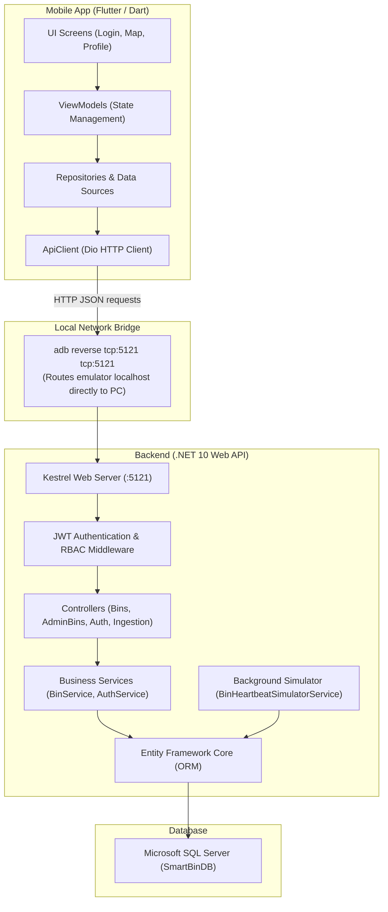

# EcoBin - Backend Integration & Interview Preparation Guide

> **Audience:** Anyone presenting or defending this project (especially mobile / frontend developers with zero C# background).  
> **Goal:** Understand every piece of backend and mobile work done on this branch, how the systems talk to each other, and how to confidently answer technical interview questions.

---

## 1. High-Level System Architecture

### The Three Main Layers:
1. **Frontend (Flutter):** Runs on the Android emulator or physical phone. It captures user interactions (typing email, pressing login, viewing the bin map) and sends HTTP requests.
2. **Backend (ASP.NET Core Web API):** Runs on your computer. It listens on port `5121`, checks security tokens, applies business logic (e.g. distance calculation), and writes/reads data.
3. **Database (SQL Server):** Holds the persistent records: users, roles, bin physical hardware status, waste categories, and session history.

---

## 2. Every Endpoint Connected in this Branch

### A. Authentication Endpoints (Member 1 Scope)

| Endpoint | Method | Who Uses It | What It Does in Plain English |
| :--- | :---: | :--- | :--- |
| `/api/v1/auth/register` | `POST` | New Citizen | Creates a new citizen account with email, name, and password. By default, it sets role to `USER_CITIZEN` and `EmailConfirmed = false`. |
| `/api/v1/auth/verify-email` | `POST` | New Citizen | Validates the 5-digit verification code sent to the citizen's email to activate the account (`EmailConfirmed = true`). |
| `/api/v1/auth/resend-verification-otp` | `POST` | Citizen | Sends a fresh 5-digit OTP if the previous one expired. |
| `/api/v1/auth/login` | `POST` | Citizen & Admin | Checks email & password, verifies that email is confirmed, and gives the user back a **JWT Access Token**. |

---

### B. Bin Discovery & Management Endpoints (Member 3 Scope)

| Endpoint | Method | Who Uses It | What It Does in Plain English |
| :--- | :---: | :--- | :--- |
| `/api/v1/bins` (`E60`) | `GET` | Mobile (Citizen) | Returns all smart bins within a **1 km radius** of the citizen's GPS coordinates. Uses the **Haversine formula** to sort bins by distance. |
| `/api/v1/bins/{binId}` (`E61`) | `GET` | Admin / Internal | Gets detailed information for a single bin. **Note:** On mobile, citizen privacy is enforced—citizens only see whether a bin is `AVAILABLE` or `UNAVAILABLE`. Technical metrics (`fillLevel`) are reserved for the Admin Dashboard. |
| `/api/v1/bins/search` (`E64`) | `GET` | Mobile (Citizen) | Allows searching bins by **district name** (e.g. "Cairo"), **serial number**, or **ID**. If GPS coordinates are passed, it automatically calculates the walking distance (in meters) and walking time (in minutes). |
| `/api/v1/admin/bins` (`E50`) | `GET` | Admin Dashboard | Returns a paginated table of all bins in the fleet with search and status filters (`ONLINE`, `OFFLINE`, `MAINTENANCE`). Protected by `[Authorize(Roles = "SYS_ADMIN")]`. |
| `/api/v1/admin/bins` (`E51`) | `POST` | Admin Dashboard | Registers a brand-new physical bin in the system with serial number and capacity threshold. Protected by `[Authorize(Roles = "SYS_ADMIN")]`. |
| `/api/v1/admin/bins/{binId}` (`E53`) | `PUT` | Admin Dashboard | Updates a bin's district, capacity threshold, or maintenance status. Protected by `[Authorize(Roles = "SYS_ADMIN")]`. |
| `/api/v1/sessions/{sessionId}/items` (`E21`) | `POST` | Smart Bin Hardware | Triggered by the physical smart bin hardware when an item is deposited. It identifies the waste material (plastic, glass, paper), logs points, and resets the 60-second session activity timer. |

---

## 3. Core Concepts Explained (No C# Knowledge Required)

### 1. What is an API & an Endpoint?
- **Analogy:** Think of the backend like a **restaurant kitchen** and the mobile app as the **customer**.
- The mobile app cannot walk into the kitchen and touch the database directly. Instead, it talks to the **waiter** (the API).
- An **endpoint** is a specific order on the menu:
  - `GET /api/v1/bins` = *"Please bring me a list of nearby bins."*
  - `POST /api/v1/auth/login` = *"Here are my credentials, please give me a VIP wristband."*

### 2. What is a JWT (JSON Web Token)?
- **Analogy:** A tamper-proof digital **VIP wristband**.
- When you log in, the server gives you a long scrambled string (`eyJhbGciOi...`).
- Inside that token is your User ID and your Role (`SYS_ADMIN` or `USER_CITIZEN`).
- The token is digitally signed with a **secret password** known only to the backend. If a user tries to alter their role from citizen to admin, the signature breaks and the server immediately rejects the request.

### 3. What is Role-Based Access Control (RBAC)?
- A security gate that checks your role before allowing access.
- An endpoint marked `[Authorize(Roles = "SYS_ADMIN")]` ensures that normal citizen users cannot create, delete, or reconfigure smart bins.

### 4. What is the Haversine Distance Formula?
- Because the Earth is a curved sphere, you cannot use simple 2D Pythagorean theorem ($a^2 + b^2 = c^2$) to calculate distance between GPS coordinates.
- The **Haversine formula** calculates the true straight-line distance (in meters) between two GPS points $(lat_1, lng_1)$ and $(lat_2, lng_2)$ taking Earth's curvature into account.
- We set the discovery limit to **1,000 meters (1 km)** so citizens only see bins within walking distance.

### 5. What is the Background Simulator (`BinHeartbeatSimulatorService`)?
- In real life, smart bins have cellular/Wi-Fi hardware that sends a "heartbeat" ping to the server every few minutes.
- If a bin stops sending pings for more than 5 minutes (due to dead battery or power failure), our background service automatically switches its status to **`OFFLINE`** so users aren't directed to a broken bin.

---

## 4. Key Real-World Bugs We Solved (Interview Goldmine!)

Interviewers love asking: *"Tell me about a difficult bug you ran into and how you solved it."*  
Here are the real bugs we hit, diagnosed, and resolved:

### Bug 1: The `403 Forbidden` on Admin Endpoints
- **What happened:** When sending an admin token to `POST /api/v1/admin/bins`, the server returned `403 Forbidden` even though the user was an Admin.
- **Root Cause:** By default in ASP.NET Core, an automatic mapping layer renames incoming JWT claims from `"role"` to a legacy SOAP URI (`http://schemas.microsoft.com/ws/2008/06/identity/claims/role`). Because the server was configured to look strictly for a claim named `"role"`, it couldn't find it and denied access!
- **The Fix:**
  1. Added `options.MapInboundClaims = false;` in `Program.cs` to prevent the framework from altering claim names.
  2. Emitted both `"role"` and `ClaimTypes.Role` in `JwtService.cs` so all authorization handlers are satisfied.

### Bug 2: Android Emulator "Connection Refused"
- **What happened:** Setting `apiBaseUrl = 'http://localhost:5121/api/v1'` caused Flutter on the Android emulator to immediately throw `Connection refused`.
- **Root Cause:** To the Android emulator, `localhost` means the **virtual Android phone itself**, not the computer running the backend.
- **The Fix:** We ran `adb reverse tcp:5121 tcp:5121`. This creates a direct socket forwarding tunnel between the emulator's port 5121 and the host PC's port 5121, allowing `localhost:5121` to work seamlessly without firewall blocks.

### Bug 3: Android Emulator "15-Second Connection Timeout"
- **What happened:** When trying `10.0.2.2:5121`, the request hung for 15 seconds and timed out.
- **Root Cause:** The backend server was initially listening only on `localhost` (loopback `127.0.0.1`), and Windows Firewall filtered virtual NAT traffic coming from the emulator's virtual network card.
- **The Fix:** Configured `launchSettings.json` to bind to `0.0.0.0:5121` (all network interfaces) and used `adb reverse` to bypass Windows Firewall completely.

### Bug 4: Citizen Privacy & Data Leaks
- **Requirement:** Citizens should never see bin fill levels (`fillLevel`) or internal hardware metrics.
- **The Fix:** In `bin_model.dart` and `map_view.dart`, `fillLevel` was removed from citizen view models. The app only displays a status badge: **`AVAILABLE`** (green) or **`UNAVAILABLE`** (red).

---

## 5. Potential Interview Questions & Strong Model Answers

### Q1: How does your mobile app communicate with your backend server?
> **Answer:**  
> "Our mobile app is built with Flutter and communicates with an ASP.NET Core RESTful Web API over HTTP using the `Dio` library. All requests send and receive JSON data. We configured an `ApiClient` with interceptors to automatically attach JWT Bearer tokens to authorized requests. For local development on Android emulators, we used `adb reverse` to establish a direct loopback tunnel to our PC's backend server."

---

### Q2: How does authentication and session management work in EcoBin?
> **Answer:**  
> "We use stateless JWT (JSON Web Token) authentication:
> 1. When a user logs in via `POST /api/v1/auth/login`, the backend verifies their hashed password using ASP.NET Core Identity.
> 2. The backend generates a signed JWT access token containing the user's ID and role (`USER_CITIZEN` or `SYS_ADMIN`).
> 3. The mobile app securely stores the token in local storage using `FlutterSecureStorage`.
> 4. Subsequent requests include this token in the `Authorization: Bearer <token>` header.
> 5. The backend validates the signature, issuer, audience, and expiration on every request."

---

### Q3: What is the difference between 401 Unauthorized and 403 Forbidden?
> **Answer:**  
> - **401 Unauthorized** means *'I don't know who you are'* (missing, expired, or invalid token).  
> - **403 Forbidden** means *'I know who you are, but you don't have permission to be here'* (e.g., a citizen user trying to access the admin fleet endpoint `POST /api/v1/admin/bins`).

---

### Q4: How does the nearby bin feature work on the map?
> **Answer:**  
> "When the citizen opens the map view, the app grabs their GPS coordinates and calls `GET /api/v1/bins?lat=...&lng=...&radiusKm=1.0`. The backend queries active bins and runs the Haversine distance formula to filter only bins within a 1-kilometer radius. Bins are returned sorted by nearest distance first. For citizen privacy, only availability status is exposed, while raw telemetry like fill level is hidden."

---

### Q5: How do you handle backend error messages in Flutter?
> **Answer:**  
> "The backend wraps errors in a standardized envelope:  
> `{ success: false, error: { code: '...', message: '...' } }`.  
> In our Flutter remote data sources, we wrote an error extractor method that unpacks this JSON error envelope and surfaces clean, human-readable error messages to the user via SnackBar alerts, rather than crashing with unhandled network exceptions."

---

### Q6: How did you verify and test your implementation?
> **Answer:**  
> "We implemented automated test suites on both ends:
> - **Backend:** xUnit tests in `SmartBin.Tests` testing bin distance calculations, registration constraints, and JWT claim parsing across different token handlers.
> - **Mobile:** Flutter widget and unit tests in `src/mobile/test` validating JSON deserialization, model parsing, and mock mode switching.  
> - **End-to-End Testing:** Tested live registration, email verification, login, and map rendering directly on an Android emulator connected to the live local database."

---

## 6. Quick Cheat Sheet

- **Backend Base URL:** `http://localhost:5121/api/v1`
- **Swagger Documentation:** `http://localhost:5121/swagger`
- **Database:** Microsoft SQL Server (`SmartBinDB`)
- **Admin Test Account:** `yosfalt333666@gmail.com` / `Admin1234!` (Role: `SYS_ADMIN`)
- **Citizen Test Account:** `yosf3336660@gmail.com` / `Admin1234!` (Role: `USER_CITIZEN`)
- **Key ADB Command:** `adb reverse tcp:5121 tcp:5121`
- **Run Backend:** `dotnet run --project src/backend/SmartBin/SmartBin/SmartBin.csproj`
- **Run Mobile:** `cd src/mobile && flutter run`
