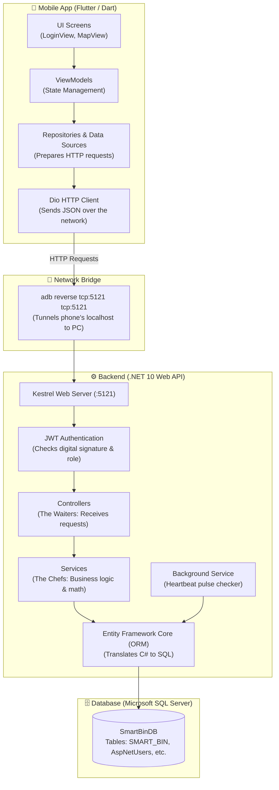

# EcoBin - Complete Backend & Mobile Integration Guide

> **Audience:** Anyone presenting or defending this project (especially mobile / frontend developers with zero C# background).  
> **Goal:** Understand every folder, every file, and every piece of code used to connect the Flutter mobile app to the .NET backend, complete with plain-English explanations and step-by-step examples.

---

## 1. High-Level Architecture: How the Whole System Fits Together



---

## 2. Folder Structure Explained (The "Restaurant" Analogy)

To make backend architecture simple to understand without any C# experience, think of the backend as a **restaurant**:

```
src/backend/SmartBin/SmartBin/
│
├── Controllers/       <-- The Waiters
├── Services/          <-- The Chefs (Kitchen)
├── Models/            <-- The Ingredients & Food Items
├── Dtos/              <-- The Menu & Order Slips
├── Context/           <-- The Kitchen Order System (Connects to Storage)
├── Migrations/        <-- Blueprints for building the Restaurant
└── Program.cs         <-- The Restaurant Manager (Opens doors, sets rules)
```

### Detailed Breakdown of Every Folder:

### 1. `Controllers/` (The Waiters)
- **Role:** Controllers are the public-facing entry points. When the mobile app sends an HTTP request, it hits a Controller first.
- **Rule:** The waiter doesn't cook the food! The controller never writes complex math or database queries. It just receives the order, passes it to the `Service`, and hands the result back to the mobile app.
- **Key files here:**
  - `AuthController.cs`: Handles `/api/v1/auth/login`, `/register`, `/verify-email`.
  - `BinsController.cs`: Handles citizen requests like `/api/v1/bins` (nearby map) and `/bins/search`.
  - `AdminBinsController.cs`: Handles admin-only requests like `/api/v1/admin/bins`.

### 2. `Services/` (The Chefs / Business Logic)
- **Role:** This is where the actual brain of the application lives.
- **What it does:** Calculates distance between coordinates using the Haversine formula, hashes passwords, generates JWT tokens, and decides if a bin is `AVAILABLE` or `UNAVAILABLE`.
- **Key files here:**
  - `BinService.cs`: Implements bin distance calculation, 1 km filtering, and sorting.
  - `AuthService.cs`: Implements user registration, password verification, and account checks.
  - `JwtService.cs`: Generates the encrypted digital token (JWT).
  - `BinHeartbeatSimulatorService.cs`: A background worker running every 10 seconds to detect dead bins.

### 3. `Models/` (The Database Entities)
- **Role:** Represents the actual tables and columns inside Microsoft SQL Server.
- **Key files here:**
  - `SmartBin.cs`: Represents the `SMART_BIN` table (Latitude, Longitude, Status, FillLevel, SerialNumber).
  - `ApplicationUser.cs`: Represents the `AspNetUsers` table (Email, DisplayName, AccountStatus).
  - `WasteType.cs`: Represents `WASTE_TYPE` (Plastic, Glass, Paper, Organic).

### 4. `Dtos/` (Data Transfer Objects — The Order Slips)
- **Role:** Defines the exact JSON structure sent into and out of endpoints.
- **Why we need it:** We never expose raw database tables to mobile apps. For example, a citizen should never see the internal database table columns like `CollectorId` or raw sensor calibration. A DTO filters and shapes the data specifically for the screen requesting it.
- **Key files here:**
  - `CitizenBinDto.cs`: Only contains `binId`, `name`, `latitude`, `longitude`, `status`, `district`. (Notice `fillLevel` is removed for citizen privacy!).
  - `LoginRequestDto.cs`: Defines `{ "email": "...", "password": "..." }`.

### 5. `Context/` (The Database Bridge)
- **File:** `AppDbContext.cs`
- **Role:** Uses **Entity Framework Core (EF Core)** to translate C# code into SQL commands (`SELECT`, `INSERT`, `UPDATE`) automatically so developers don't have to write raw SQL strings by hand.

### 6. `Mobile: src/mobile/lib/` (The Flutter Client Architecture)
```
src/mobile/lib/
├── core/
│   ├── config/app_config.dart        <-- Holds backend URL (http://localhost:5121/api/v1)
│   └── network/api_client.dart       <-- Configures Dio with timeouts and token headers
└── features/
    ├── auth/
    │   ├── data/datasources/         <-- Calls auth API endpoints via Dio
    │   ├── data/models/              <-- Parses JSON into Dart objects safely
    │   └── presentation/views/       <-- Login, Register, VerifyEmail UI screens
    └── map_bins/
        ├── data/datasources/         <-- Calls /bins and /bins/search
        ├── data/models/bin_model.dart<-- Parses bin JSON (AVAILABLE / UNAVAILABLE badge)
        └── presentation/views/       <-- MapView showing pins and walking routes
```

---

## 3. Code Walkthrough: What Every Key Code Snippet Does

Here is the exact code we wrote/used, explained simply line-by-line:

---

### Snippet 1: The Citizen Nearby Bins Endpoint (`BinsController.cs`)

```csharp
[HttpGet]
public async Task<IActionResult> GetNearbyBins(
    [FromQuery] double? lat,
    [FromQuery] double? lng,
    [FromQuery] double? radiusKm = 1.0)
{
    var bins = await _binService.GetNearbyBinsAsync(lat, lng, radiusKm);
    return Ok(new { success = true, data = bins });
}
```

#### What this code does in plain English:
1. `[HttpGet]`: Tells the server: *"Listen for GET requests at `/api/v1/bins`"*.
2. `[FromQuery] double? lat, lng, radiusKm = 1.0`: Reads the coordinates from the URL parameters (e.g. `?lat=30.04&lng=31.23`). If the mobile app doesn't specify a radius, it **defaults to 1.0 km**.
3. `await _binService.GetNearbyBinsAsync(...)`: Hands the coordinates to the Chef (`BinService`) to do the math.
4. `return Ok(new { success = true, data = bins })`: Sends back HTTP 200 with the formatted JSON list.

#### Example:
- **Mobile Sends:** `GET http://localhost:5121/api/v1/bins?lat=30.044&lng=31.235`
- **Backend Returns:**
  ```json
  {
    "success": true,
    "data": [
      {
        "binId": 1,
        "name": "Bin#001",
        "latitude": 30.0440,
        "longitude": 31.2359,
        "status": "AVAILABLE",
        "district": "Cairo"
      }
    ]
  }
  ```

---

### Snippet 2: The 1km Haversine Distance Filter (`BinService.cs`)

```csharp
foreach (var bin in bins)
{
    double dist = 0;
    if (lat.HasValue && lng.HasValue && bin.Latitude.HasValue && bin.Longitude.HasValue)
    {
        dist = CalculateHaversineDistance(
            lat.Value, lng.Value,
            (double)bin.Latitude.Value, (double)bin.Longitude.Value);

        double maxDistMeters = (radiusKm ?? 1.0) * 1000.0;
        if (dist > maxDistMeters)
        {
            continue; // Skip this bin, it is too far away!
        }
    }
    result.Add((bin, dist));
}
```

#### What this code does in plain English:
1. `CalculateHaversineDistance(...)`: Measures the straight-line distance in meters between the citizen's phone and the smart bin on the curved surface of the Earth.
2. `maxDistMeters = (radiusKm ?? 1.0) * 1000.0`: Converts kilometers to meters ($1.0 \text{ km} \times 1000 = 1000 \text{ meters}$).
3. `if (dist > maxDistMeters) continue;`: If the bin is 1,200 meters away, it is ignored and dropped from the results. Only bins $\le 1000$ meters make the cut!
4. `result.Add((bin, dist))`: Adds the valid bin to the list.

---

### Snippet 3: Admin Protection & Claim Fix (`Program.cs` & `AdminBinsController.cs`)

In `AdminBinsController.cs`:
```csharp
[ApiController]
[Route("api/v1/admin/bins")]
[Authorize(Roles = "SYS_ADMIN")]
public class AdminBinsController : ControllerBase
```

In `Program.cs`:
```csharp
.AddJwtBearer(options =>
{
    options.MapInboundClaims = false;
    options.TokenValidationParameters = new TokenValidationParameters
    {
        ValidateIssuer = true,
        ValidateAudience = true,
        ValidateLifetime = true,
        ValidateIssuerSigningKey = true,
        RoleClaimType = "role",
        NameClaimType = "id"
    };
});
```

#### What this code does in plain English:
1. `[Authorize(Roles = "SYS_ADMIN")]`: Puts a security guard on this controller. If the token doesn't say `SYS_ADMIN`, reject with **`403 Forbidden`**.
2. `options.MapInboundClaims = false;`: Stops ASP.NET from translating the clean JSON key `"role"` into a 100-character XML web link.
3. `RoleClaimType = "role"`: Tells the security guard: *"Check the tag named `role` on the user's token to see if they are an admin."*

---

### Snippet 4: Mobile Safe ID & Status Parser (`bin_model.dart`)

```dart
factory BinModel.fromJson(Map<String, dynamic> json) {
  final rawStatus = (json['status'] ?? 'AVAILABLE').toString().toUpperCase();
  final isAvailable = rawStatus == 'AVAILABLE' || rawStatus == 'ONLINE';

  return BinModel(
    binId: json['binId']?.toString() ?? '',
    name: json['name'] ?? 'Smart Bin',
    latitude: (json['latitude'] as num?)?.toDouble() ?? 0.0,
    longitude: (json['longitude'] as num?)?.toDouble() ?? 0.0,
    status: isAvailable ? 'AVAILABLE' : 'UNAVAILABLE',
    district: json['district'],
  );
}
```

#### What this code does in plain English:
1. `json['binId']?.toString()`: Protects against crashes! In SQL Server, IDs are integers (`1, 2, 3`), but Flutter UI components expect a `String` (`"1", "2"`). Calling `.toString()` prevents type-cast exceptions.
2. `isAvailable ? 'AVAILABLE' : 'UNAVAILABLE'`: **Privacy protection!** The backend might store internal states like `MAINTENANCE` or `FAULTY`, but the citizen app simplifies this into either a green **AVAILABLE** or red **UNAVAILABLE** badge.

---

### Snippet 5: Mobile Error Envelope Unpacker (`auth_remote_data_source.dart`)

```dart
String _extractErrorMessage(dynamic data, String fallback) {
  if (data is Map<String, dynamic>) {
    final errorObj = data['error'];
    if (errorObj is Map<String, dynamic>) {
      final msg = errorObj['message'];
      if (msg != null && msg.toString().isNotEmpty) {
        return msg.toString();
      }
    }
  }
  return fallback;
}
```

#### What this code does in plain English:
When the backend rejects a request (e.g. wrong password), it returns:
```json
{
  "success": false,
  "error": {
    "code": "INVALID_CREDENTIALS",
    "message": "Invalid email or password."
  }
}
```
This helper method digs inside `data['error']['message']` to extract `"Invalid email or password."` and displays it in a clean red SnackBar on the phone, instead of showing an ugly crash or generic error.

---

## 4. The 4 Network Bugs We Solved (Interview Showcase)

| Problem Encountered | Error Code / Message | Why it Happened | How We Fixed It |
| :--- | :--- | :--- | :--- |
| **Password Rejected** | `400 Validation Error: The registration data is invalid.` | ASP.NET Identity requires at least 1 uppercase, 1 lowercase, 1 digit, and **1 special symbol** (`!@#$`). `"Admin1234"` failed, but `"Admin1234!"` succeeded. | Instructed the user to use passwords with a special symbol (`Admin1234!`). |
| **Admin Access Denied** | `403 Forbidden` on `/api/v1/admin/bins` | ASP.NET Core renamed incoming `"role"` claim to `http://schemas...`, so the `[Authorize(Roles = "SYS_ADMIN")]` check couldn't find the role. | Added `options.MapInboundClaims = false;` in `Program.cs` and added `ClaimTypes.Role` in `JwtService.cs`. |
| **Connection Refused** | `Connection refused` on Android Emulator | The app tried to connect to `localhost:5121`. On an Android emulator, `localhost` means the virtual phone itself, not the PC! | Ran `adb reverse tcp:5121 tcp:5121` so the emulator's port 5121 directly tunnels to the host PC's port 5121. |
| **15s Timeout** | `The request connection took longer than 0:00:15.000000` | Connecting to `10.0.2.2` got dropped by Windows Defender Firewall or Kestrel listening only on `127.0.0.1`. | Updated `launchSettings.json` to bind to `0.0.0.0:5121` and used the `adb reverse` tunnel. |

---

## 5. Potential Interview Questions & Strong Model Answers

### Q1: How does your mobile app communicate with your backend server?
> **Answer:**  
> "Our mobile app is built with Flutter and communicates with an ASP.NET Core RESTful Web API over HTTP using the `Dio` library. All requests send and receive JSON data. We configured an `ApiClient` with interceptors to automatically attach JWT Bearer tokens to authorized requests. For local development on Android emulators, we used `adb reverse` to establish a direct loopback tunnel to our PC's backend server."

---

### Q2: How does authentication and session management work in EcoBin?
> **Answer:**  
> "We use stateless JWT (JSON Web Token) authentication:
> 1. When a user logs in via `POST /api/v1/auth/login`, the backend verifies their hashed password using ASP.NET Core Identity.
> 2. The backend generates a signed JWT access token containing the user's ID and role (`USER_CITIZEN` or `SYS_ADMIN`).
> 3. The mobile app securely stores the token in local storage using `FlutterSecureStorage`.
> 4. Subsequent requests include this token in the `Authorization: Bearer <token>` header.
> 5. The backend validates the signature, issuer, audience, and expiration on every request."

---

### Q3: What is the difference between 401 Unauthorized and 403 Forbidden?
> **Answer:**  
> - **401 Unauthorized** means *'I don't know who you are'* (missing, expired, or invalid token).  
> - **403 Forbidden** means *'I know who you are, but you don't have permission to be here'* (e.g., a citizen user trying to access the admin fleet endpoint `POST /api/v1/admin/bins`).

---

### Q4: How does the nearby bin feature work on the map?
> **Answer:**  
> "When the citizen opens the map view, the app grabs their GPS coordinates and calls `GET /api/v1/bins?lat=...&lng=...&radiusKm=1.0`. The backend queries active bins and runs the Haversine distance formula to filter only bins within a 1-kilometer radius. Bins are returned sorted by nearest distance first. For citizen privacy, only availability status is exposed, while raw telemetry like fill level is hidden."

---

### Q5: How do you handle backend error messages in Flutter?
> **Answer:**  
> "The backend wraps errors in a standardized envelope:  
> `{ success: false, error: { code: '...', message: '...' } }`.  
> In our Flutter remote data sources, we wrote an error extractor method that unpacks this JSON error envelope and surfaces clean, human-readable error messages to the user via SnackBar alerts, rather than crashing with unhandled network exceptions."

---

### Q6: How did you verify and test your implementation?
> **Answer:**  
> "We implemented automated test suites on both ends:
> - **Backend:** xUnit tests in `SmartBin.Tests` testing bin distance calculations, registration constraints, and JWT claim parsing across different token handlers.
> - **Mobile:** Flutter widget and unit tests in `src/mobile/test` validating JSON deserialization, model parsing, and mock mode switching.  
> - **End-to-End Testing:** Tested live registration, email verification, login, and map rendering directly on an Android emulator connected to the live local database."

---

## 6. Quick Cheat Sheet

- **Backend Base URL:** `http://localhost:5121/api/v1`
- **Swagger Documentation:** `http://localhost:5121/swagger`
- **Database:** Microsoft SQL Server (`SmartBinDB`)
- **Admin Test Account:** `yosfalt333666@gmail.com` / `Admin1234!` (Role: `SYS_ADMIN`)
- **Citizen Test Account:** `yosf3336660@gmail.com` / `Admin1234!` (Role: `USER_CITIZEN`)
- **Key ADB Command:** `adb reverse tcp:5121 tcp:5121`
- **Run Backend:** `dotnet run --project src/backend/SmartBin/SmartBin/SmartBin.csproj`
- **Run Mobile:** `cd src/mobile && flutter run`
